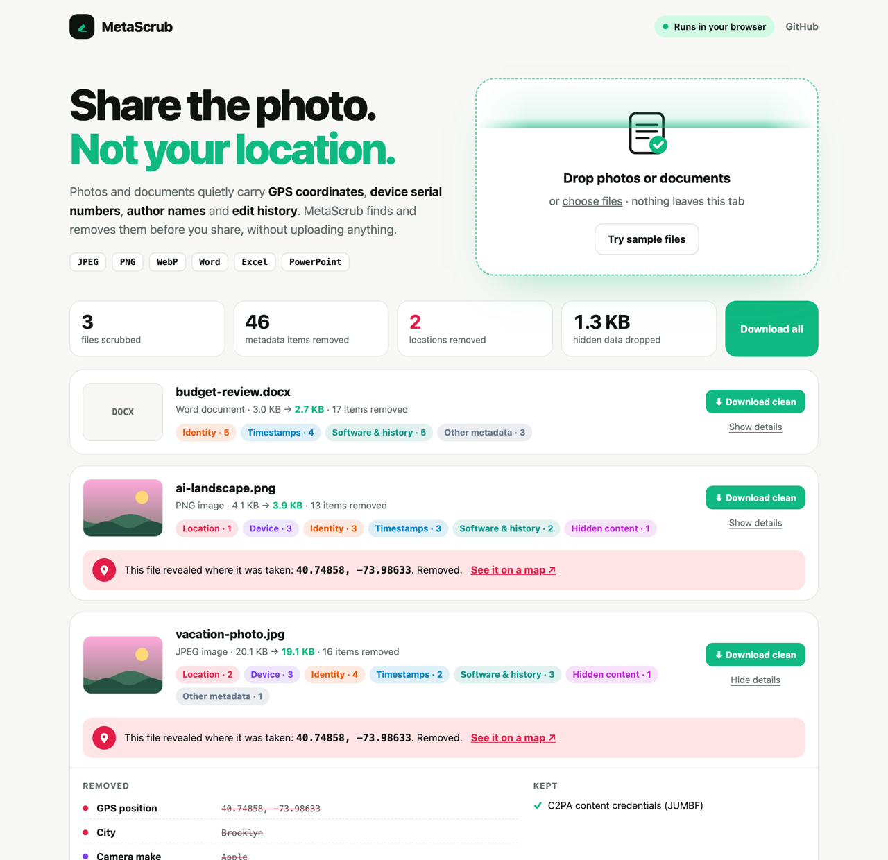

<p align="center">
  
</p>

<p align="center">
  <a href="https://zecongyu.github.io/MetaScrub/#demo"></a>
</p>

<p align="center">
  <a href="https://github.com/liuxiaomingskm/datashield-lightweight-labs"></a>
  
  
  
  
</p>

<p align="center"><i>Developed under the <a href="https://github.com/liuxiaomingskm/datashield-lightweight-labs">DataShield Lightweight Labs</a> initiative.</i></p>

---

### 🤔 What does your photo say about you?

More than you think. This is what was hiding inside an ordinary-looking holiday photo (the [sample file](samples/vacation-photo.jpg); every name and number is fictional):

```diff
- 📍 GPS position        40.74858, -73.98633         ← the exact street it was taken on
- 📍 City                Brooklyn
- 📱 Camera              Apple iPhone 15 Pro
- 📱 Body serial number  SN-ABC123456                ← links every photo from this phone
- 👤 Camera owner        Jordan Avery
- 🕒 Taken               2026:10:01 09:59:58
- 🛠️ Edited with          Lightroom 13 → Photoshop 26 (2 recorded steps)
- 🧩 Hidden data          18 bytes after the end of the image
+ ✅ Kept                C2PA content credentials and every pixel
```

Office files leak too: **author, "last modified by", company, manager, comment authors, tracked-change authors, print dates and total editing time.**

### ✨ What does MetaScrub do?

You drop files in, and get clean copies back. **Nothing is uploaded**; all processing happens in the browser tab.

<p align="center">
  <picture>
    <source media="(prefers-color-scheme: dark)" srcset="assets/screenshot-dark.png" />
    
  </picture>
</p>

| | Format | What gets removed |
|:-:|---|---|
| 🖼️ | **JPEG** | EXIF (GPS, make/model, serials, owner, dates, software, maker notes, thumbnail), XMP (creator, city, edit history), IPTC / Photoshop blocks, comments, vendor segments, data hidden after the image |
| 🖼️ | **PNG** | `tEXt` / `iTXt` / `zTXt` (author, software, comments, AI prompts), `eXIf`, `tIME`, unknown chunks |
| 🖼️ | **WebP** | EXIF and XMP chunks (container flags and sizes rewritten correctly) |
| 📄 | **Word · Excel · PowerPoint** | Author, last modified by, company, manager, template, revision, editing time, print / create / modify dates, custom properties, comment and tracked-change authors, people lists, ZIP comment and timestamps |

### 🛡️ What does it keep, and why?

| Kept | Why |
|---|---|
| **Every pixel and every word** | Images aren't re-encoded and document text isn't touched, so there's no quality loss |
| **Orientation** | So photos don't suddenly turn sideways |
| **Colour profile** | So colours look the same |
| **AI disclosure** | C2PA content credentials and the IPTC *"AI-generated"* label are always kept. If a PNG has an AI prompt, the **prompt is removed** (it can contain names and places) but the **label stays**. MetaScrub protects *people*, not the fact that an image was made by AI. |

### 🔐 Can I trust it?

- **No network.** The page makes no requests with your files: no server, no analytics, no storage. Open DevTools → Network and check.
- **Byte-level, not re-encoding.** MetaScrub walks the file structure (JPEG segments, PNG chunks, RIFF chunks, ZIP entries) and drops or rewrites only the metadata parts. PNG chunk CRCs and ZIP CRCs are recalculated, and RIFF sizes and WebP flags are fixed.
- **Tested.** 12 test groups build real files with GPS, serials and authors injected, then check that nothing leaks, the result is still valid, and a second pass finds nothing. Scrubbed outputs were also checked with macOS `sips` / `textutil` and Python `zipfile`.
- **Honest about limits** (below).

### ⚠️ What doesn't it do (yet)?

- **PDF, HEIC/AVIF, TIFF, GIF, video**: not supported yet. You'll see a clear message instead of a half-cleaned file.
- **Comment and tracked-change text** in Office files stays in place (authors are anonymised). MetaScrub tells you how many there are; delete or accept them in Office before sharing.
- **What's in the picture or the text itself.** A street sign in the background or a name in paragraph two is content, not metadata.

### 🚀 How do I use it?

**In the browser:** open **[zecongyu.github.io/MetaScrub](https://zecongyu.github.io/MetaScrub/#demo)**, drop files, and download the clean copies. Click **Try sample files** to see it on the fictional samples.

**In code (Node 18+ or browser):**

```js
const { scrub } = require('./src/metascrub.js');
const fs = require('fs');

scrub(fs.readFileSync('photo.jpg'), 'photo.jpg').then((r) => {
  r.findings;  // [{ category: 'location', label: 'GPS position', value: '40.74858, -73.98633', lat, lon }, …]
  r.kept;      // ['Colour profile (ICC)', 'Orientation (6)', …]
  r.warnings;  // e.g. '2 tracked changes remain (authors anonymised)…'
  fs.writeFileSync('photo-clean.jpg', r.output);
});
```

**Run the tests:**

```bash
git clone https://github.com/zecongyu/MetaScrub.git && cd MetaScrub
npm test
```

<details>
<summary><b>📁 What's in the repo?</b></summary>

```
index.html               The app
src/metascrub.js         Engine: JPEG / PNG / WebP / OOXML parsers and writers (no dependencies)
src/app.js               UI
src/styles.css           Mint-and-ink theme, light and dark
samples/                 Fictional demo files full of metadata
tests/                   node --test suite + fixtures
assets/                  Banner and screenshots
```

</details>

### 🧭 What's next?

- [ ] PDF (Info dictionary + XMP, including object streams)
- [ ] HEIC / AVIF and TIFF
- [ ] Optional removal of Office comments and auto-accept of tracked changes
- [ ] Batch download as a single ZIP
- [ ] Command-line version for CI and file servers

### 🧩 How does it fit into DataShield?

MetaScrub was **developed under the [DataShield Lightweight Labs](https://github.com/liuxiaomingskm/datashield-lightweight-labs) initiative**, alongside tools for AI prompts ([AI-Privacy-Guardrail](https://github.com/liuxiaomingskm/AI-Privacy-Guardrail)), clinical notes ([MedRedact](https://github.com/liuxiaomingskm/MedRedact)) and cloud configs ([cloud-sec-auditor](https://github.com/liuxiaomingskm/cloud-sec-auditor)). MetaScrub covers **📷 media and documents: remove personal metadata before you share.**

---

<p align="center"><sub>MIT © 2026 zecongyu · No uploads, no analytics, no storage · ⭐ Star it if it kept your address out of a group chat</sub></p>
